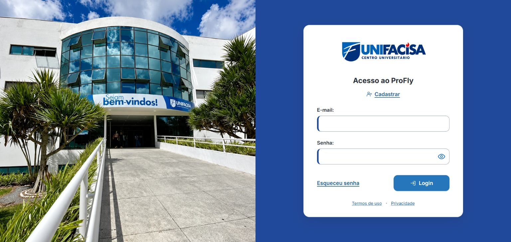
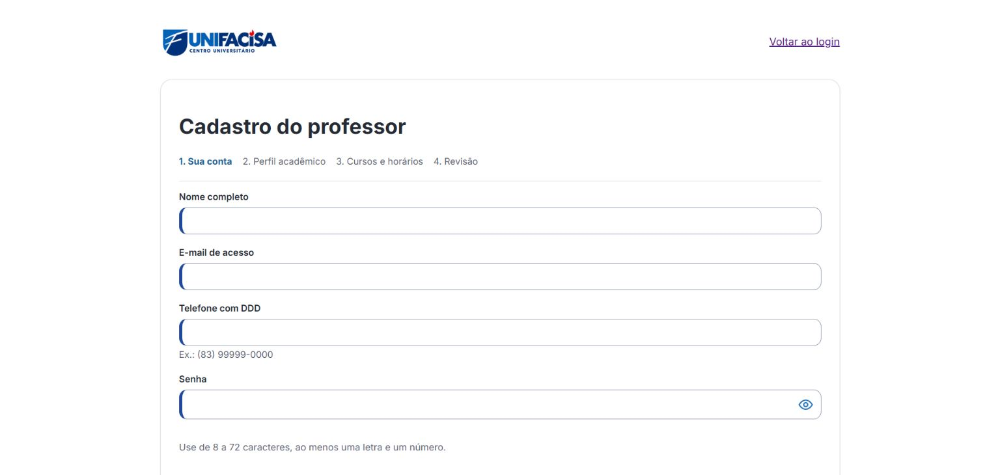
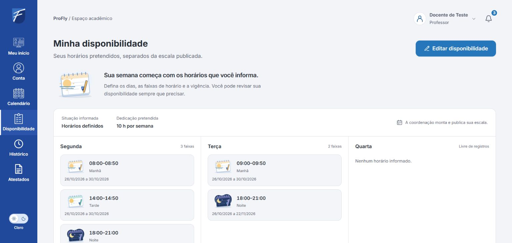
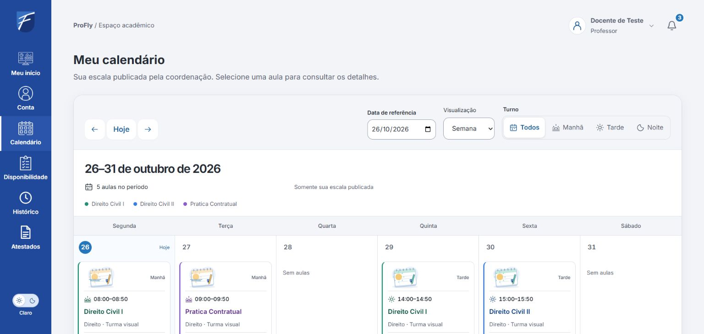
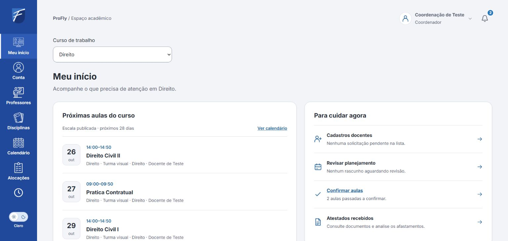
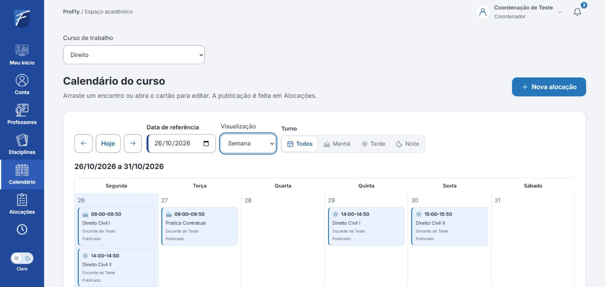

# ProFly

**Plataforma de gestão e alocação docente para os cursos da UNIFACISA.**

O ProFly organiza informações de professores, disciplinas, competências e disponibilidade para apoiar a montagem das escalas acadêmicas. Cada coordenador trabalha nos cursos pelos quais é responsável; o professor acompanha suas aulas em uma visão reunida; o administrador mantém a estrutura institucional e as responsabilidades de acesso.

O projeto nasceu no curso de Direito e está sendo ampliado para atender aos demais cursos da faculdade. Este README apresenta a visão do produto completo. A implementação disponível e o trabalho ainda pendente estão identificados na seção [Estado de desenvolvimento](#estado-de-desenvolvimento).

## Conheça as telas

Capturas de **26/10/2026**, com a interface conectada à API e contas fictícias de professor e coordenador. As imagens mostram a área visível da tela; páginas e modais mais longos continuam pela rolagem.

| Acesso ao ProFly | Cadastro do professor |
| --- | --- |
|  |  |

| Disponibilidade do professor | Calendário do professor |
| --- | --- |
|  |  |

| Início da coordenação | Calendário do curso |
| --- | --- |
|  |  |

## O problema que queremos resolver

Distribuir aulas exige combinar o conteúdo de cada disciplina com os conhecimentos do professor, seus horários e sua carga de trabalho. A mesma pessoa pode atuar em vários cursos, o que torna necessário conferir compromissos de forma compartilhada, respeitando os limites de acesso de cada coordenação.

O ProFly busca centralizar essas informações, explicar as possibilidades de alocação e reduzir conferências manuais. O sistema recomenda candidatos e aponta restrições; a decisão final da atribuição permanece com a coordenação.

## Quem utiliza

| Perfil | Responsabilidades |
| --- | --- |
| Administrador | Cadastrar cursos e coordenadores e atribuir as responsabilidades de cada coordenação. |
| Coordenador | Gerenciar professores e disciplinas no contexto de seus cursos, analisar solicitações de entrada, consultar compatibilidade e organizar alocações e horários. |
| Professor | Preencher seu perfil, solicitar participação, informar disponibilidade, consultar a própria escala e o histórico de aulas e comunicar ausências com atestado. |

Uma pessoa pode atuar em mais de um curso sem precisar de perfis docentes duplicados. A aprovação em um curso não concede acesso automático a outro. A autorização deve ser conferida também no servidor em cada operação.

## Fluxo principal

1. O administrador organiza os cursos e seus coordenadores.
2. O professor preenche seus dados e solicita participação nos cursos e disciplinas selecionados. A coordenação também pode iniciar seu cadastro por convite, respeitando o mesmo controle de acesso.
3. O coordenador responsável analisa a solicitação, aprova, pede ajustes ou recusa. Enquanto aguarda, o professor acompanha os próprios dados e solicitações.
4. Ao organizar uma oferta de disciplina para uma turma e um período, a coordenação consulta os professores elegíveis e os motivos da recomendação.
5. A coordenação monta e publica a escala conforme o fluxo definido; o professor consulta seus horários e mantém as informações permitidas do perfil.

Solicitação de participação, aprovação de aptidões e atribuição de aulas são etapas distintas. A aprovação de entrada não cria uma alocação automaticamente.

## Funcionalidades do produto

### Perfil docente detalhado

Cadastro progressivo de identificação, formação, áreas de atuação, conhecimentos específicos, experiência docente, experiência profissional e disponibilidade. O professor pode completar as seções por etapas, com orientação sobre o que falta informar ou analisar.

Os dados necessários à recomendação têm origem e situação explícitas: declarados, pendentes de análise ou confirmados. O cadastro distingue falta de informação de ausência conhecida de experiência. O limite institucional de carga é separado da dedicação pretendida pelo professor.

### Organização acadêmica

Cursos, competências, disciplinas, períodos letivos, turmas e ofertas. Cada disciplina possui uma ficha de conhecimentos obrigatórios, conhecimentos desejáveis e critérios de experiência. Uma oferta representa aquela disciplina para uma turma em determinado período.

### Elegibilidade e compatibilidade

A indicação combina uma árvore de decisões binárias com uma pontuação explicável:

- **Elegibilidade:** confere vínculo aprovado, formação exigida quando aplicável, cada conhecimento obrigatório, disponibilidade, conflitos e carga horária. A quantidade de verificações acompanha os requisitos da disciplina.
- **Classificação:** compara os candidatos elegíveis pelos conhecimentos desejáveis e experiências pertinentes, mostrando como cada fator contribuiu para o resultado.

O resultado é específico para professor, disciplina/oferta, horários e período. Dados obrigatórios desconhecidos deixam a avaliação pendente. Um professor pode atender aos requisitos obrigatórios e ainda ter score pendente por informações de classificação incompletas.

A configuração inicial de 60 pontos para conhecimentos, 25 para experiência docente e 15 para experiência profissional é uma **proposta para revisão com a coordenação**. Pesos, requisitos reais e limites acadêmicos ainda precisam dessa revisão. O score não representa uma probabilidade de sucesso e não atribui aulas automaticamente.

Detalhes, nós de decisão, fórmula e exemplos fictícios estão na [proposta de compatibilidade](docs/PROPOSTA_COMPATIBILIDADE.md).

### Alocações e calendário

Planejamento por curso, turma e período, com seleção de dia e turno. Os cartões de aula representam disciplina, turma e professor e podem ser incluídos, editados e movimentados por arraste, com alternativa por formulário.

Toda alteração precisa conferir novamente os horários reais, os compromissos do professor em outros cursos e sua carga. Disputas simultâneas entre coordenações devem preservar a integridade da escala. A proposta de trabalho inclui rascunho e versão publicada estável; rascunhos salvos e a última publicação mantêm reservas globais até uma nova revisão atômica. Essa política conservadora permanece proposta para homologação institucional.

### Dashboard e histórico do professor

Uma entrada simples reúne a situação das solicitações, aulas de hoje/semana, perfil acadêmico, disponibilidade e comunicação de ausência.

O histórico recente mostra as **últimas 10 aulas**, reunindo os cursos do professor, com disciplina, turma, data, horário e situação. Há acesso ao histórico completo com filtros e paginação. Uma aula apenas agendada ou com data passada não é considerada realizada automaticamente.

O histórico pertinente confirmado pode compor a experiência usada na recomendação, com deduplicação e critérios próprios. A janela de 10 itens é somente um recorte de navegação.

### Ausências e atestados

O professor informa o período de ausência, pode anexar o atestado em fluxo reservado e acompanha o retorno da coordenação responsável. As aulas afetadas são sinalizadas para tratamento.

O afastamento afeta a disponibilidade nas datas aplicáveis e preserva o score acadêmico e os conhecimentos do professor. O documento não aparece na recomendação. Seu envio não apaga, redistribui ou republica aulas automaticamente.

## Direção visual

Preservar a estética do front-end existente, reaproveitando componentes, modais, campos, botões e tokens de estilo. Os novos fluxos devem ampliar essa base de forma consistente, com uso por teclado e em telas menores.

As referências incluem os [protótipos originais](docs/prototipos/README.md), a [referência do Figma](docs/prototipos/FIGMA.md) e os recursos institucionais já presentes no repositório. Materiais adicionais podem partir das referências oficiais da UNIFACISA registradas na documentação.

## Tecnologias e arquitetura

| Camada | Tecnologia / direção |
| --- | --- |
| Front-end existente | React, TypeScript, Vite, React Router, CSS Modules e variáveis CSS. |
| Back-end implementado | Node.js, TypeScript, Fastify, validação Zod e API REST. |
| Banco definido | MongoDB, com configuração coordenada por outro integrante do grupo. |
| Qualidade do front-end | Vitest, Testing Library, ESLint e Prettier já configurados. |
| Qualidade do back-end | Spec, matriz rastreada, comando único de tipos/lint/build e testes de domínio, HTTP, MongoDB, concorrência, privacidade e documentos. |

Arquitetura pretendida:

```text
Interface por perfil
        |
        v
API Node.js: identidade, autorização, validação e regras de negócio
        |
        v
MongoDB: cadastros, vínculos, planejamento, histórico e versões

Anexos de atestado: armazenamento privado com acesso autorizado pela API
```

A aplicação deve rejeitar dados incoerentes e operações fora do escopo, manter estados explícitos e retornar erros úteis aos formulários. Validação no navegador complementa as verificações do servidor.

## Documentação do projeto

| Documento | Conteúdo |
| --- | --- |
| [Spec do back-end](docs/specs/BACKEND_V1.md) | Requisitos rastreáveis, contratos, invariantes, limites e critérios de aceitação. |
| [Matriz de cenários](docs/specs/backend-cases.json) | 66 cenários planejados para testes de domínio, contratos, autorização, integração, concorrência e entradas adversariais. |
| [Fluxo de trabalho](docs/WORKFLOW.md) | Ordem de implementação, ciclo de validação e commits por área. |
| [Estado das validações](docs/validation/STATUS.md) | O que foi verificado e o que ainda está pendente ou não implementado. |
| [Definição do back-end](docs/BACKEND.md) | Modelo conceitual, responsabilidades, dados e contratos com o responsável pelo banco. |
| [Compatibilidade docente](docs/PROPOSTA_COMPATIBILIDADE.md) | Cadastro, árvore detalhada, score, dashboard, histórico e exemplos. |
| [Expansão institucional](docs/EXPANSAO_INSTITUCIONAL.md) | Contexto, decisões tomadas e etapas da ampliação. |
| [Interface e demonstração preservada](docs/FRONTEND_ATUAL.md) | Funcionamento, rotas e limitações da implementação existente. |
| [Orientações de trabalho](AGENTS.md) | Regras do repositório para preservar a base, validar e salvar entregas em commits. |

## Desenvolvimento por etapas

Usar **spec e ciclo de validação em conjunto**: definir o comportamento, implementar uma parte coerente, testar casos válidos e inválidos, corrigir falhas, conferir regressões pertinentes e salvar a entrega em commit.

A sequência começa pela estrutura do back-end, identidade e permissões, cadastro/aprovação, organização acadêmica, elegibilidade/score, alocações/publicação, ausências/histórico e integração das telas. A ordem detalhada está no [fluxo de trabalho](docs/WORKFLOW.md).

Cada entrega recebe commit com área identificada, por exemplo:

```text
feat(frontend): adiciona formulario de disponibilidade
feat(backend): valida solicitacao por curso
test(backend): cobre reserva simultanea do professor
docs(project): apresenta o projeto institucional completo
```

Alterações de front-end e back-end ficam em commits separados. Testes e documentação relacionados podem acompanhar sua funcionalidade. Um teste planejado, pulado ou indisponível não conta como aprovado.

## Estado de desenvolvimento

Atualizado em **26/10/2026**. Branch local: `feat/backend-institucional`. A interface usa a API por padrão; a demonstração anterior foi preservada como opção explícita.

| Parte | Estado atual |
| --- | --- |
| Identidade e conta | Sessão real por cookie/CSRF, cadastro detalhado, confirmação de e-mail, recuperação, troca protegida de e-mail/senha e foto privada. |
| Aprovação por curso | Solicitações encaminhadas após verificar o e-mail; análise exclusiva do coordenador com vínculo ativo no curso, inclusive para quem acumula papel de administrador. Sem aprovação automática. |
| Administração | Cursos, coordenadores, convites, revogação, competências, períodos/grade e limite institucional de carga. Primeiro administrador exige configuração explícita. |
| Perfil e catálogo | Perfil versionado, formação, conhecimentos, experiências, horários pretendidos e dedicação opcional; disciplinas, critérios, turmas e ofertas pela API. |
| Elegibilidade e score | Árvore explicável e comparação consistente de candidatos, com dados desconhecidos pendentes e pesos/requisitos configuráveis como proposta. |
| Planejamento | Rascunhos, arraste/formulário, reservas globais, versão esperada e publicação atômica; escala anterior preservada em falha. |
| Professor | Agenda publicada, últimas 10 aulas, histórico paginado, horas realizadas confirmadas versus meta opcional. |
| Ausências | Comunicação e decisão por curso, sinalização temporária e atestado privado JPG/PNG/WebP e PDF passivo pela interface conectada; retomada de upload, download privado e paginação. |
| Comprovantes acadêmicos | API de documentos privados por versão/item do perfil, imutáveis, auditados, com quotas e retirada sem apagar o original; integração dos novos controles no frontend pendente. |
| Notificações | Avisos internos, paginação, total não lido e preferência persistida; e-mails de segurança independentes. |
| E-mail | SMTP implementado e testado em captura fictícia local. Entrega externa depende de remetente autenticado. |
| Validação | Fechamento local com comando backend/scripts/verify.mjs; rastreabilidade dos 68 cenários em [aceitação do backend](docs/validation/BACKEND_ACCEPTANCE.md), histórico em [STATUS.md](docs/validation/STATUS.md). |

A implementação está validada para demonstração acadêmica local e não equivale à homologação institucional. O MongoDB configurado ainda falhou na conexão TLS na conferência desta etapa, sem desativar validação de certificados. Ainda faltam remetente real, configuração inicial da administração, revisão de critérios/grade/limites e políticas de privacidade/retenção, infraestrutura HTTPS e verificações de produção. Não inserir atestados reais na prévia de desenvolvimento.

A base de implementação foi localizada em `claude/pensive-dirac-5rithn`, no commit `6e78ca6`. Na leitura inicial, a `main` continha apenas referências e protótipos. Esses dados registram a origem da etapa, sem presumir publicação desta branch no remoto.

## O que falta para a entrega

A base está validada para **demonstração acadêmica local** nos cenários documentados. A última verificação registrou **74 testes de backend, 18 da interface conectada e 220 gerais de frontend aprovados**, além de tipos, lint e build. O código do backend foi comparado novamente ao relatório nesta revisão e permanece igual. A captura das telas não substitui testes de fluxo nem homologação de produção.

Antes de considerar a operação institucional concluída:

- [ ] Conectar os controles de **comprovantes acadêmicos**, a tela geral de **gestão de usuários** e a navegação das listas adicionais que ainda usam só uma página. As APIs correspondentes já existem.
- [ ] Resolver e validar a conexão com o **MongoDB definitivo**. A última conferência dessa configuração falhou em TLS; os testes aprovados usam MongoDB local descartável.
- [ ] Configurar e verificar **remetente real de e-mail, domínio/HTTPS, backup e restauração e capacidade de produção**. A caixa fictícia local não entrega mensagens ao Gmail.
- [ ] Homologar **grade, carga, requisitos e pesos do score**, além de responsáveis, canal, bases e retenção de dados. Dados clínicos reais continuam bloqueados na prévia.

O detalhe por perfil está no [checklist de entrega](docs/CHECKLIST_PERFIS.md), e as evidências estão na [aceitação do backend](docs/validation/BACKEND_ACCEPTANCE.md). Os pesos demonstrativos, a aprovação da conta fictícia e os registros históricos de teste não representam decisões da instituição.

## Executar a aplicação conectada

Use Node.js 24. Na raiz:

```bash
npm ci
npm run dev
```

O Vite atende em [127.0.0.1:5174](http://127.0.0.1:5174) e encaminha `/api` para `127.0.0.1:3333`. Inicie também o [backend](backend/README.md), com MongoDB transacional e seu `backend/.env` local. URI e credenciais ficam somente no servidor; nunca em variáveis `VITE_*`. `PROFLY_API_TARGET` altera apenas o destino do proxy de desenvolvimento.

Não há credencial administrativa padrão na aplicação conectada. Crie o primeiro administrador com o procedimento explícito do backend; ele cadastra cursos e convida coordenadores. O professor usa **Cadastrar**, confirma o e-mail e aguarda análise independente de cada curso. Conectar a API não importa nem apaga cadastros locais antigos.

### Demonstração anterior

Somente para apresentação com dados fictícios: defina `VITE_DEMO_MODE=true` antes de iniciar o Vite. A credencial demonstrativa `felipe.araujo@profly.test` / `profly123` funciona apenas nesse modo. Dados antigos de `localStorage` e sessão de `sessionStorage` foram preservados; não autenticam na API.

### Verificações

```bash
npm run typecheck
npm run lint
npm run build
npm test -- --maxWorkers=2
npm run test:api
node scripts/check-docs.mjs
```

`test:api` habilita explicitamente testes de interface com API real e MongoDB efêmero, sem ler `.env`. Não utiliza o banco institucional. As suítes do servidor estão em [backend/README.md](backend/README.md). Prévia isolada com contas sintéticas e configuração do envio estão em [interface conectada](docs/INTERFACE_API.md) e [e-mail](docs/EMAIL_BACKEND.md).

O proxy do Vite é somente de desenvolvimento: a hospedagem precisa configurar `/api`, HTTPS, origens e cabeçalhos. A barreira atual mantém acesso em loopback até homologação. Consulte [Segurança do ambiente](docs/SEGURANCA.md). A configuração opcional para desenvolvimento está em [HTTPS local](docs/HTTPS_LOCAL.md), sem instalar certificados automaticamente.

## Organização do repositório

```text
src/institutional/     Interface conectada à API
src/                   Componentes, tokens e demonstração anterior preservada
public/images/         Imagens e recursos visuais
docs/specs/            Spec e matriz de cenários do back-end
docs/validation/       Registro das verificações e limitações
docs/prototipos/       Protótipos e referências originais
docs/                  Contexto, propostas e fluxo de desenvolvimento
scripts/               Verificador documental
AGENTS.md              Regras de trabalho e commits
```

A estrutura do servidor está em [backend](backend/README.md). Modelos, índices, ambiente de desenvolvimento e requisitos de transação devem ser combinados com o integrante responsável pelo MongoDB. Os testes de integração usam um MongoDB temporário real e isolado; a conclusão integrada exige validar todos os fluxos previstos.

Privacidade e atendimento ao titular: [controles e pendências de LGPD](docs/LGPD.md). O uso real permanece dependente das definições institucionais; somente os controles documentados/testados são considerados implementados.

Revisão de funcionalidades e pendências de professor, coordenador e administrador: [checklist dos perfis](docs/CHECKLIST_PERFIS.md).

### Experiência docente e estados de serviço

Calendário pessoal com cadernos ilustrados para manhã/tarde/noite e cores estáveis por disciplina; disponibilidade em quadro semanal com edição em modal; histórico em linha do tempo com filtros da página e detalhes consultivos. Atestados aceitam PDF passivo e imagens pelo mesmo fluxo autenticado, mantendo análise por curso. Há telas institucionais de 404, carregamento e manutenção, com SVGs próprios e identidade UNIFACISA; animações respeitam a preferência de movimento reduzido.

Na prévia local, consulte `/404`, `/carregando` e `/manutencao` para visualizar os estados. A manutenção real é controlada por `MAINTENANCE_MODE` no backend e está desligada por padrão; o bootstrap trata `503 MAINTENANCE` sem invalidar a sessão. A conta fictícia recebeu cinco registros históricos adicionais, sem alterar as cinco aulas publicadas da semana. Esses registros são exclusivamente demonstrativos; não habilitam importação de aulas passadas em contas institucionais.
