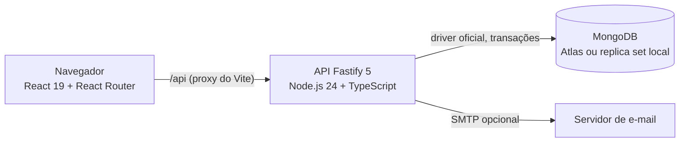
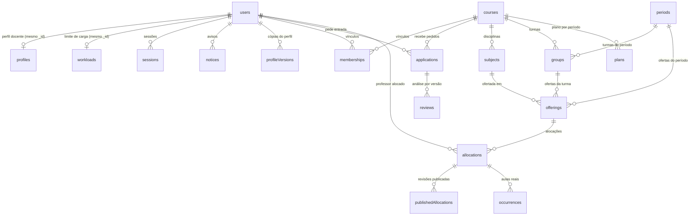
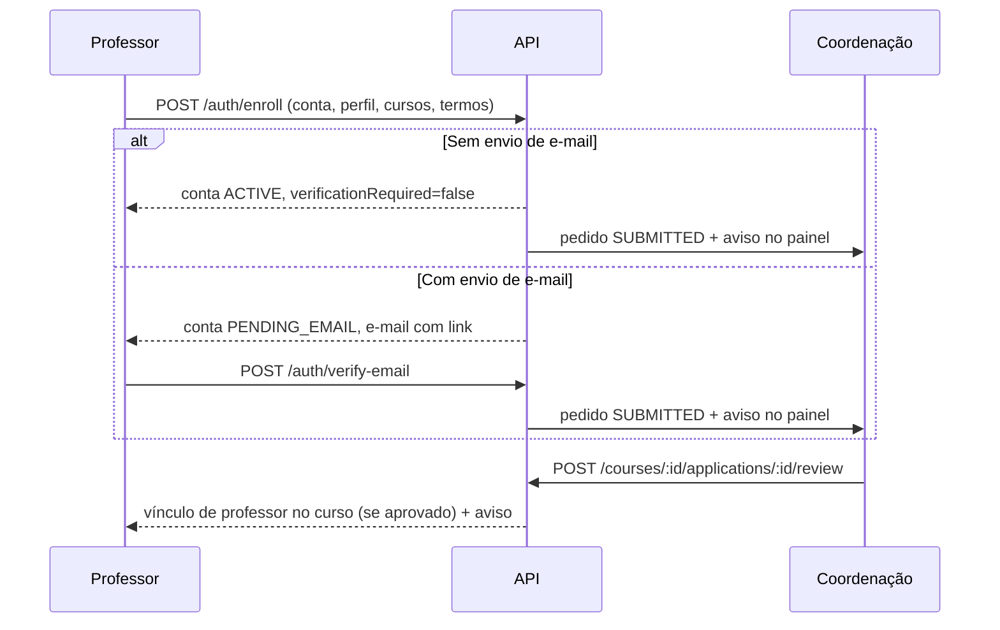

# Documentação técnica do ProFly

Atualizada em 09/11/2026. Visão de engenharia do sistema: arquitetura, dados, regras, API, configuração e testes. Para o uso das telas, veja o [manual do usuário](MANUAL_USUARIO.md); para contratos e cenários detalhados, a [spec do back-end](specs/BACKEND_V1.md) e a [matriz de cenários](specs/backend-cases.json).

- [Arquitetura](#arquitetura)
- [Organização do código](#organização-do-código)
- [Modelo de dados e relacionamentos](#modelo-de-dados-e-relacionamentos)
- [Fluxos principais](#fluxos-principais)
- [Árvore de elegibilidade e pontuação](#árvore-de-elegibilidade-e-pontuação)
- [API](#api)
- [Segurança](#segurança)
- [Configuração](#configuração)
- [Testes](#testes)
- [Decisões recentes](#decisões-recentes)
- [Limitações conhecidas](#limitações-conhecidas)

## Arquitetura



| Camada | Tecnologia | Responsabilidade |
| --- | --- | --- |
| Interface | React 19, React Router 7, Vite 8, CSS Modules | Telas por papel, formulários e calendário. Nunca é fonte de confiança para permissões ou regras. |
| API | Fastify 5, Zod 4, TypeScript | Autenticação por cookie, CSRF, validação de entrada, autorização por curso, regras de negócio e motor de elegibilidade. |
| Banco | MongoDB 7 com transações | Persistência, índices únicos e travas (`guards`) para operações concorrentes. |
| E-mail | Nodemailer (SMTP) | Confirmação de e-mail e recuperação de senha. Opcional: sem ele o cadastro segue direto para a coordenação. |

A interface usa a API por padrão (`src/institutional`). A demonstração antiga, só no navegador (`src/features`), abre apenas com `VITE_DEMO_MODE=true`.

## Organização do código

```text
src/institutional/        Interface conectada à API (todas as telas atuais)
  apiRoutes.tsx           Rotas e permissões por papel
  AuthPages.tsx           Login, cadastro em etapas, confirmação, senha
  AcademicPages.tsx       Professores (análise, vínculos) e disciplinas
  PlanningPages.tsx       Alocações, comparação de professores, publicação
  CalendarPage.tsx        Calendário de professor e coordenação
  AccountPages.tsx        Conta, perfil, disponibilidade, histórico, pedidos
  AdminPage.tsx           Cursos, coordenadores, competências, períodos, carga
src/components/           Componentes visuais compartilhados
backend/src/
  identity/               Usuários, sessão, cadastro, cursos, coordenação
  teachers/               Perfil docente, solicitações e análise por curso
  academics/              Competências, períodos, disciplinas, turmas, ofertas
  scheduling/             Motor de elegibilidade, alocações, publicação, agenda
  documents/              Comprovantes acadêmicos (API pronta)
  privacy/                Atendimento ao titular (LGPD)
  shared/                 HTTP, erros, paginação, criptografia, travas
backend/test/             Testes unitários e de integração (MongoDB efêmero)
docs/                     Manual, especificações, validação e decisões
```

## Modelo de dados e relacionamentos

O MongoDB não tem chaves estrangeiras: as coleções se ligam por identificadores (UUID em texto) e a integridade é garantida pela API, dentro de transações. Vários dados ficam **embutidos** no documento em vez de ter coleção própria.



**Um para um** (mesmo `_id` do usuário): `profiles` (perfil acadêmico), `workloads` (limite semanal de carga, uma vigência por professor), `preferences`, `photos` e `registrationIntents` (pedidos aguardando confirmação de e-mail).

**Um para muitos**:

| Pai | Filhos | Observação |
| --- | --- | --- |
| `users` | `sessions`, `tokens`, `notices`, `audit`, `privacyRequests`, `academicDocuments`, `profileVersions` | `profileVersions` guarda uma cópia imutável por versão do perfil. |
| `courses` | `subjects`, `groups`, `offerings`, `plans`, `allocations`, `applications`, `reviews` | Tudo que é acadêmico pertence a um curso. |
| `periods` | `groups`, `offerings`, `plans` | Períodos e competências são globais, mantidos pela administração. |
| `offerings` | `allocations` | Oferta = disciplina + turma + período + encontros. |
| `allocations` | `publishedAllocations`, `occurrences` | Rascunho, revisões publicadas e aulas reais (com situação). |
| `applications` | `reviews` | Uma análise por versão do perfil. |

**Muitos para muitos**:

| Relação | Como é feita |
| --- | --- |
| Usuário ↔ Curso | Coleção `memberships`, com papel (`coordinator` ou `teacher`) e `active`. Índice único em usuário + curso + papel. |
| Professor ↔ Curso (pedido) | Coleção `applications`, uma por professor e curso, com situação `SUBMITTED`, `APPROVED`, `CHANGES_REQUESTED` ou `REJECTED`. |
| Pedido ↔ Disciplinas | Lista `subjectIds` embutida no pedido e na análise. |
| Perfil ↔ Competências | `knowledge` (competência + nível) e `competencyIds` das experiências, embutidos no perfil. |
| Disciplina ↔ Competências | Ficha `criteria` embutida: obrigatórias com nível mínimo, desejáveis com peso. |

**Embutidos**: formações, conhecimentos, experiências e janelas de disponibilidade (no perfil); encontros (na oferta); blocos da grade (no período); slots com datas e horários (na alocação).

As alterações acadêmicas guardam versões em `academicVersions` e autoria em `audit`. A coleção `guards` serializa operações concorrentes (por exemplo, duas coordenações reservando o mesmo professor).

## Fluxos principais

### Cadastro e entrada no curso



A aprovação cria apenas o vínculo; não cria aulas. Cada curso decide de forma independente.

### Perfil e nova análise

Toda gravação do perfil gera uma nova versão. Se **formação, conhecimentos ou experiências** não mudaram, as análises da versão anterior continuam valendo (copiadas com `carriedFromVersion`), e o professor segue elegível. Se mudaram, o professor reenvia o pedido e a coordenação analisa de novo.

### Alocação e publicação

1. A coordenação escolhe uma oferta; a API expande os encontros em datas (`slots`).
2. `POST /recommendations` avalia todos os professores do curso; `POST /eligibility` avalia um.
3. Salvar cria ou altera um **rascunho** (`allocations`, estado `DRAFT`); a API reavalia antes de gravar.
4. `POST /periods/:id/publish` reavalia todos os rascunhos do curso e período. A publicação é **tudo ou nada**: se algum não estiver elegível, nada muda e a resposta lista cada alocação bloqueante.
5. Publicar cria as aulas reais (`occurrences`) que o professor vê; aulas passadas nunca são reescritas.

## Árvore de elegibilidade e pontuação

Implementação: `backend/src/scheduling/engine.ts`. Para cada professor e oferta, todas as verificações são feitas, e cada uma termina em `PASS`, `FAIL`, `PENDING` (falta dado ou análise) ou `CONFIGURATION_PENDING` (falta configuração).

| Ordem | Verificação | Fonte |
| --- | --- | --- |
| 1 | Vínculo aprovado no curso | `memberships` |
| 2 | Ficha de critérios revisada | `subjects.criteria.status` |
| 3 | Grade do período revisada e encontros definidos | `periods.calendarStatus` |
| 4 | Perfil atual analisado neste curso para a disciplina | `reviews` |
| 5 | Formação mínima confirmada | perfil + análise |
| 6 | Cada conhecimento obrigatório confirmado no nível mínimo | perfil + análise |
| 7 | Experiência docente e profissional mínimas | perfil + análise + histórico |
| 8 | Disponibilidade cobre todos os encontros | perfil |
| 9 | Sem choque com aulas em qualquer curso (inclui rascunhos) | `allocations` + `publishedAllocations` |
| 10 | Turma livre nos horários | idem |
| 11 | Dentro do limite semanal de carga | `workloads` |

Resultado: algum `FAIL` → **não elegível**; senão algum `CONFIGURATION_PENDING` → **configuração pendente**; senão algum `PENDING` → **pendente**; senão **elegível**.

Só os elegíveis recebem pontuação, limitada a 100: conhecimentos desejáveis (peso 60), experiência docente (25) e profissional (15), cada fator proporcional ao alvo da ficha. Os pesos são **proposta configurável** por disciplina, não regra institucional. Empates dividem a posição. A pontuação não atribui aulas: a decisão é da coordenação.

## API

Base `/api/v1`. O contrato completo está em [`backend/docs/openapi.json`](../backend/docs/openapi.json) (regerado com `pnpm openapi` em `backend`).

| Grupo | Rotas principais | Quem usa |
| --- | --- | --- |
| Autenticação | `POST /auth/login`, `/auth/logout`, `GET /auth/session`, `POST /auth/enroll`, `/auth/verify-email`, `/auth/forgot-password`, `/auth/reset-password`, `/auth/invites/accept` | Todos |
| Conta | `PUT /me/account`, `POST /me/password`, `/me/email-change`, `/me/photo` | Todos |
| Perfil e pedidos | `GET/PUT /me/profile`, `GET /me/applications`, `POST /me/applications/:courseId` | Professor |
| Análise | `GET /courses/:id/applications`, `POST .../applications/:id/review`, `POST /courses/:id/teachers/:id/unlink` | Coordenação do curso |
| Catálogo | `/admin/competencies`, `/admin/periods`, `/courses/:id/subjects`, `/groups`, `/offerings` | Administração e coordenação |
| Planejamento | `POST /courses/:id/eligibility`, `/recommendations`, `/allocations`, `GET /planning`, `POST /periods/:id/publish` | Coordenação |
| Agenda | `GET /me/schedule`, `/me/history`, `GET /courses/:id/occurrences`, `POST .../occurrences/:id/status` | Professor e coordenação |
| Administração | `/admin/courses`, `/admin/coordinators`, `/admin/users`, `/admin/teachers/:id/workload` | Administração |
| Avisos | `GET /me/notifications`, `POST /me/notifications/:id/read`, `/me/preferences` | Todos |
| Saúde | `GET /health/live`, `/health/ready`, `/api/v1/status` | Infraestrutura |

Erros seguem o formato `{ error: { code, message, fieldErrors?, requestId } }`. Listas são paginadas (`limit`, `offset`, `nextOffset`).

## Segurança

- Sessão em cookie `HttpOnly`, `SameSite=Strict`, com caminho `/api/v1`; token de CSRF obrigatório em toda alteração.
- Origens permitidas por `ALLOWED_ORIGINS`; cabeçalhos de segurança via Helmet; limite de tentativas nas rotas de autenticação.
- Senhas com hash forte; tokens de e-mail de uso único com validade de uma hora (convites: 48 horas).
- Autorização conferida no servidor em cada operação, por papel e por vínculo ativo no curso. Analisar pedidos exige ser coordenador do curso, mesmo para administradores.
- A interface só abre em `localhost`/`127.0.0.1` até a homologação institucional (`src/app/demoEnvironment.ts`).
- Detalhes: [segurança do ambiente](SEGURANCA.md) e [LGPD](LGPD.md).

## Configuração

Arquivo `backend/.env` (modelo em `backend/.env.example`; nunca versionar):

| Variável | Uso |
| --- | --- |
| `MONGODB_URI` | Conexão com o MongoDB. No Windows, prefira o formato direto `mongodb://host1,host2,host3/...` ao `mongodb+srv://`. |
| `MONGODB_DATABASE` | Nome do banco (`profly_development` nas apresentações). Em testes, precisa terminar em `_test`. |
| `PORT`, `HOST` | Endereço da API (padrão `127.0.0.1:3333`). |
| `ALLOWED_ORIGINS` | Origens da interface autorizadas a chamar a API. |
| `EMAIL_TRANSPORT` | `disabled` (cadastro direto para a coordenação) ou `smtp`. |
| `SMTP_*`, `PUBLIC_APP_URL` | Envio de e-mail e endereço usado nos links, quando `smtp`. |
| `SESSION_HOURS` | Duração da sessão. |
| `MAINTENANCE_MODE` | `true` recusa a API com aviso de manutenção. |
| `PRIVACY_*` | Parâmetros de privacidade pendentes de definição institucional. |

Primeiro administrador em banco vazio: `pnpm create-admin` com `BOOTSTRAP_ADMIN_NAME`, `BOOTSTRAP_ADMIN_EMAIL` e `BOOTSTRAP_ADMIN_PASSWORD`.

## Testes

| Comando | Onde | O que verifica |
| --- | --- | --- |
| `npm run typecheck`, `npm run lint`, `npm run build` | raiz | Tipos, estilo e build da interface |
| `npm test` | raiz | 220 testes de componentes e regras da interface |
| `npm run test:api` | raiz | 17 testes da interface contra a API real com MongoDB efêmero |
| `pnpm typecheck`, `pnpm lint` | `backend` | Tipos e estilo do servidor |
| `pnpm test:unit` | `backend` | 22 testes unitários |
| `PROFLY_RUN_INTEGRATION=1 pnpm test:integration` | `backend` | 57 testes de integração com MongoDB efêmero (baixa o binário na primeira vez) |
| `node scripts/check-docs.mjs` | raiz | Links da documentação e matriz de cenários |

Em 09/11/2026 os fluxos principais também foram executados no navegador (Playwright + Edge) contra o MongoDB Atlas do projeto, em banco separado `profly_e2e_test`. Evidências em [STATUS.md](validation/STATUS.md).

## Decisões recentes

| Data | Decisão | Cenário |
| --- | --- | --- |
| 09/11/2026 | Mudanças só de horário, dedicação ou telefone mantêm a análise da coordenação. | CASE-071 |
| 09/11/2026 | Publicação continua atômica, mas aponta cada alocação bloqueante. | CASE-072 |
| 09/11/2026 | Período e turma em uso aceitam alterações que não invalidam aulas. | CASE-073 |
| 09/11/2026 | Coordenação pode encerrar o vínculo de um professor sem aulas futuras. | CASE-074 |
| 09/11/2026 | Listas da coordenação com nome de quem pediu, busca e filtros por data. | CASE-075 |
| 09/11/2026 | Sem envio de e-mail, o cadastro vai direto para a aprovação da coordenação. | CASE-076 |
| 09/11/2026 | Atestados e afastamentos ficam com o RH, fora do ProFly. | REQ-10 |

## Limitações conhecidas

- Sem envio de e-mail, a titularidade do endereço não é comprovada e a recuperação de senha não funciona.
- Comprovantes acadêmicos e gestão geral de usuários têm API, mas ainda não têm tela.
- Feriados são exibidos, mas não cancelam aulas automaticamente.
- O limite de carga guarda uma vigência por professor; ao vencer, precisa ser renovado.
- Pesos da pontuação, grade e requisitos são propostas que dependem de homologação da coordenação.
- Hospedagem com HTTPS, domínio, backup e remetente institucional de e-mail ainda não foram configurados.
